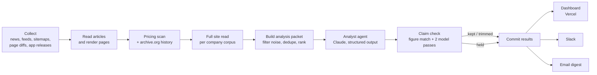

# Competitive Intelligence Monitor

A daily market-intelligence system I built for a UK venue-technology startup. Every morning it collects what competitors, clients and the wider market did, has Claude write short findings, checks each finding against its source with two independent model passes, and delivers the result to a company-wide Slack channel and a password-protected web dashboard. An email digest is built in as a third channel.

The source code is private company property, so this repository describes the system rather than shipping it.

## What it does

- **Watches about 35 companies**, a dozen of them direct competitors, plus the company's own clients and a set of market topics.
- **Collects from many kinds of source**: news searches, company blogs and RSS feeds, sitemaps (new pages), watched web pages (line-level text diffs), App Store releases, pricing pages, and archive.org history.
- **Reads competitor websites in full** every day and keeps a corpus per company, so "new page" means never seen before, not "rotated into today's sample".
- **Writes findings with Claude**: one fact, then what it means for the business, from a packet of the day's most relevant items.
- **Checks every finding before anyone sees it**: figures and quotes must appear in the source, and two independent model passes (one of them adversarial) must both clear each claim. The checker may only delete sentences, never rewrite them. A finding whose main fact fails is held back.
- **Delivers** a short Slack message only when a direct competitor moved or a client made a major move (change of owner, new chief executive, event cancelled), with the source linked under every finding. Quiet days send nothing.
- **Runs unattended** on a GitHub Actions schedule, commits its own results, and the dashboard redeploys on Vercel automatically.

## How it works

The daily run is a chain of small Python modules, each with one job, each reading what the step before wrote:

| Step | Job |
|---|---|
| Collect | News, feeds, sitemaps, watched pages and App Store releases, with per-company match rules so a company named after a common word does not pull in unrelated headlines |
| Read | Fetches article text; a headless browser layer renders JavaScript-heavy pages |
| Pricing | Reads live pricing pages daily and rebuilds price history from archive.org and Common Crawl |
| Site read | Reads each competitor's site and records what is genuinely new against everything ever seen |
| Analyse | Builds the packet, calls Claude for findings, runs the claim check, merges results |
| Notify | Slack message, failure alerts, health alerts, email digest |
| Dashboard | A single-page site with competitor cards, a capability matrix, pricing history, printable briefs and an activity feed |

## The agent design

Two kinds of model call run each morning:

1. **The analyst** receives up to 25 ranked items plus a memory of what was already reported (the last few days for everything, the last 60 days for any company in today's packet). It returns structured JSON: the fact, the implication, a confidence, and whether a client item is a major move. Bookkeeping such as company, URL and sources is joined back from the source item by key, never taken from the model's output.
2. **The checkers** read each finding beside its own sources only. One pass checks; a second pass assumes there is an error and hunts for it. A claim flagged by either pass is cut. If either pass cannot run, the finding is held as "could not be fully checked".

Deterministic code sits around both: figure and quote matching, noise filters (ticking counters, date labels, site-wide menu edits, comment widgets), old-work filters, and the rules for what reaches Slack.

## Problems I solved along the way

- **Old content reported as new.** Sampling a site's pages each day made pages that rotated into the sample look newly published. Fixed by keeping a per-company record of every page ever seen and requiring a date, a sitemap first-listing or archive.org evidence before anything is called new.
- **A fact checker that made things worse.** Allowed to rewrite, the checker once turned a true sentence false. It now deletes only, and the decision logic is a pure function with offline tests.
- **Repeat stories.** A two-week-old story was re-sent because the analyst's memory covered four days. Memory now scales with the companies in the day's packet.
- **Diffing a truncated copy.** Stored page text was capped but compared against the full live page, so long pages always looked changed. The diff now compares only what the stored copy covers.
- **Entity collisions.** Company names that are common words matched unrelated headlines. Each company carries its own must/any/none match rules, with tests built from the real collisions.
- **Silent failures.** A crash, an empty analysis step or a dead collector used to look exactly like a quiet market. There are now separate alerts for a failed run, a failed analysis and 48 hours without collection.
- **Rate-limited archives.** archive.org refuses fast reads; history reads are paced and retried, with Common Crawl as a fallback.
- **Cost.** The whole daily analysis, including both checking passes, runs at roughly $0.20 to $0.40 a day.

## Quality and testing

- Every module has an offline self-test; the daily run will not start unless all of them pass.
- A regression suite replays real past errors (with their real sources) and real good findings through the claim check, and fails if a known error gets through.
- Every finding the system ever wrote, kept or held, is stored with its reason, so a hand audit can trace any message back to its source.

## Numbers (October 2026)

| | |
|---|---|
| Python modules | 10 (about 10,000 lines including the dashboard) |
| Commits | 180+ since August 2026 |
| Items collected | about 4,800 |
| Findings written | 300+, of which 67 were held back by the claim check |
| Regression cases | 17 real cases |
| Daily cost | about $0.20 to $0.40 |

## Tech

Python (standard library plus the Anthropic SDK and crawl4ai for rendering), Claude with structured outputs and adaptive thinking, GitHub Actions on a cron schedule, Vercel static hosting with edge middleware for login, Slack incoming webhooks, SMTP email, archive.org CDX and Common Crawl.

## My role

I designed and built the system end to end since August 2026, working with Claude Code for much of the implementation, and ran it in production for the company: daily audits of the output against sources, fixing each error at its cause, and adding a test so it could not recur.
